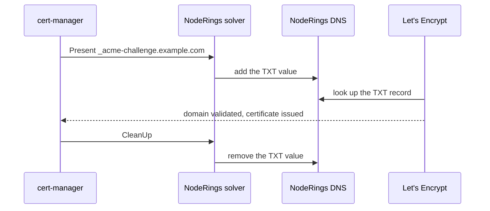

# cert-manager-webhook-noderings

[](https://github.com/noderings/cert-manager-webhook-noderings/actions/workflows/ci.yml)
[](https://github.com/noderings/cert-manager-webhook-noderings/releases)
[](https://cert-manager.io)
[](LICENSE)

A [cert-manager](https://cert-manager.io) ACME DNS-01 solver for
[NodeRings DNS](https://noderings.com). cert-manager uses it to prove to Let's Encrypt (or
any ACME CA) that you control a domain hosted in NodeRings DNS, by writing the
`_acme-challenge` TXT record and removing it afterwards. With DNS-01 you can get wildcard
certificates (`*.example.com`) and certificates for hosts that are not reachable from the
internet.



## Before you start

- cert-manager 1.15 or newer (tested with 1.21) and Helm 3.
- A zone hosted in NodeRings DNS whose domain's nameservers point at NodeRings (Let's
  Encrypt looks the challenge up on the public DNS).
- A NodeRings service account token that can manage DNS records in that zone
  (**Settings → Service accounts**).

## Install

```sh
helm install noderings-webhook oci://ghcr.io/noderings/charts/cert-manager-webhook-noderings \
  --namespace cert-manager

kubectl -n cert-manager create secret generic noderings-token --from-literal=token=<TOKEN>
```

Install it in the namespace where cert-manager runs. If cert-manager is not in
`cert-manager`, or its service account has another name, set `certManager.namespace` and
`certManager.serviceAccountName`.

## Issue a certificate

A ClusterIssuer for Let's Encrypt. Start with the staging server until everything works,
then switch to `https://acme-v02.api.letsencrypt.org/directory`:

```yaml
apiVersion: cert-manager.io/v1
kind: ClusterIssuer
metadata:
  name: letsencrypt-noderings
spec:
  acme:
    server: https://acme-staging-v02.api.letsencrypt.org/directory
    email: you@example.com
    privateKeySecretRef:
      name: letsencrypt-noderings-account
    solvers:
      - dns01:
          webhook:
            groupName: acme.noderings.com
            solverName: noderings
            config:
              tokenSecretRef:
                name: noderings-token
                key: token
```

```yaml
apiVersion: cert-manager.io/v1
kind: Certificate
metadata:
  name: example-com
  namespace: default
spec:
  secretName: example-com-tls
  issuerRef:
    name: letsencrypt-noderings
    kind: ClusterIssuer
  dnsNames:
    - example.com
    - "*.example.com"
```

```sh
kubectl get certificate example-com -w
```

For Ingresses, the usual `cert-manager.io/cluster-issuer: letsencrypt-noderings`
annotation works too.

## Solver config

| Field | Default | Meaning |
|---|---|---|
| `tokenSecretRef.name` | (required, see below) | Secret with the NodeRings token. |
| `tokenSecretRef.key` | `token` | Key in that Secret. |
| `organizationId` | | Organization to act in, for tokens that reach several. |
| `apiUrl` | `https://api.noderings.com` | API endpoint. |
| `ttl` | `60` | TTL of the challenge record, in seconds. |

A **ClusterIssuer** reads the Secret from cert-manager's cluster resource namespace
(`cert-manager` by default). A namespaced **Issuer** reads it from its own namespace; allow
that in the chart with `secretAccess.namespaces: [team-a, team-b]` (or
`secretAccess.allNamespaces: true`).

Instead of `tokenSecretRef`, a ClusterIssuer can use a token set on the solver itself:
install the chart with `ambientCredentials.secretName=noderings-token`.

## Chart values

| Value | Default | Meaning |
|---|---|---|
| `groupName` | `acme.noderings.com` | API group Issuers refer to. Change it only to run two copies. |
| `certManager.namespace` / `.serviceAccountName` | `cert-manager` / `cert-manager` | Who may call the solver. |
| `secretAccess.namespaces` | `[]` (cert-manager's namespace) | Namespaces whose Secrets the solver may read. |
| `secretAccess.allNamespaces` | `false` | Allow every namespace. |
| `secretAccess.secretNames` | `[noderings-token]` | Secret names it may read; empty allows any. |
| `ambientCredentials.secretName` | | Default token for ClusterIssuers without `tokenSecretRef`. |
| `image.repository` / `.tag` | `ghcr.io/noderings/cert-manager-webhook-noderings` / app version | Image. |

See [`values.yaml`](deploy/cert-manager-webhook-noderings/values.yaml) for resources,
security context and scheduling.

## How it behaves

- **Several keys on one name.** A certificate for `example.com` and `*.example.com` puts
  two keys on `_acme-challenge.example.com` at the same time. The solver adds and removes
  only its own value and keeps the others; with the last value gone it deletes the record.
- **Zone lookup.** It uses the zone cert-manager resolved. If NodeRings does not host that
  exact zone, it picks the longest NodeRings zone that contains the challenge name.
- **Idempotent.** Presenting a key twice or cleaning it up twice is harmless.

## Troubleshooting

| Symptom | Check |
|---|---|
| Challenge stuck in `pending`, "propagation check failed" | The domain's nameservers do not point at NodeRings, so public resolvers cannot see the record. `dig _acme-challenge.example.com TXT @ans1.nrings.io` shows whether NodeRings has it. |
| "reading Secret …: forbidden" | The Issuer's namespace or Secret name is not allowed; see `secretAccess`. |
| "no NodeRings DNS zone hosts …" | The token cannot see a zone for that name. Check the zone exists and `organizationId`. |
| APIService `v1alpha1.acme.noderings.com` not available | The webhook pod is not ready: `kubectl -n cert-manager logs deploy/noderings-webhook-cert-manager-webhook-noderings`. |

## Development

```sh
make test               # unit tests against an in-memory API
make lint               # golangci-lint and helm lint
make test-conformance   # cert-manager's DNS-01 conformance suite against the real API (needs NODERINGS_TOKEN)
NODERINGS_TOKEN=... hack/e2e.sh   # kind + cert-manager + Pebble ACME server + the real API
```

Both live tests create a throwaway zone and check the records on the NodeRings nameserver
directly, so the zone needs no delegation; they delete it afterwards.

The NodeRings DNS client in `internal/nrdns` is shared with
[external-dns-noderings-webhook](https://github.com/noderings/external-dns-noderings-webhook);
fixes there should land in both repositories.

## Related

- [external-dns-noderings-webhook](https://github.com/noderings/external-dns-noderings-webhook):
  DNS records for your Ingresses and Services in the same zones.

## License

[Apache-2.0](LICENSE)
